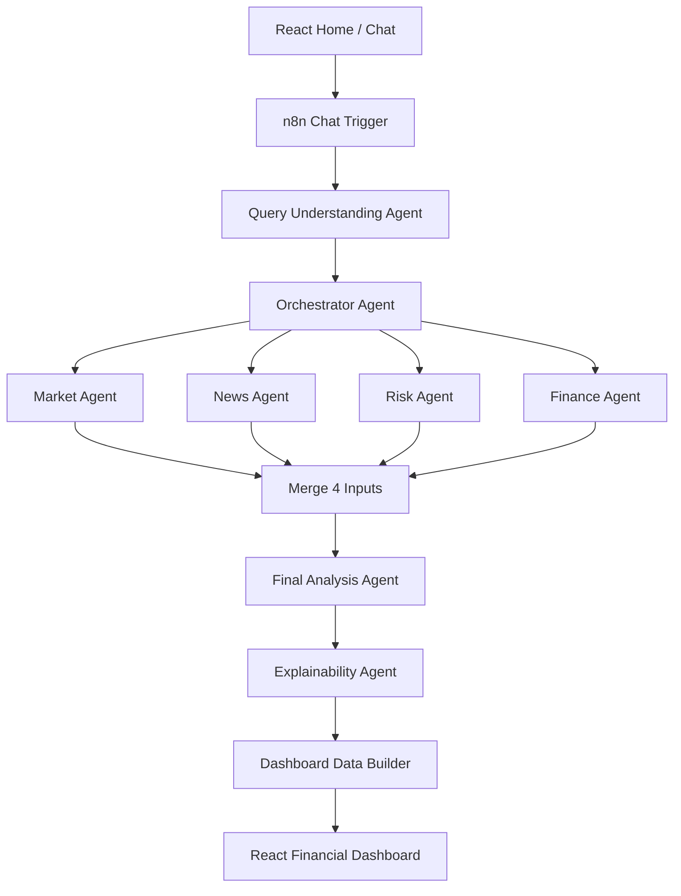

<p align="center">
  
</p>

<h1 align="center">FinSight AI</h1>

<p align="center">
  <strong>Explainable Multi-Agent LLM Framework for Intelligent Financial Decision Support</strong>
</p>

<p align="center">
  <a href="#-features"><strong>Features</strong></a> •
  <a href="#-architecture"><strong>Architecture</strong></a> •
  <a href="#-quick-start"><strong>Quick Start</strong></a> •
  <a href="#-screenshots"><strong>Screenshots</strong></a> •
  <a href="#-tech-stack"><strong>Tech Stack</strong></a> •
  <a href="#-project-structure"><strong>Structure</strong></a> •
  <a href="#-documentation"><strong>Documentation</strong></a>
</p>

<p align="center">
  
  
  
  
  
  
  
</p>

---

## 🎯 Overview

FinSight AI is a **seminar/demo prototype** that transforms natural language financial questions into structured, explainable research reports. It coordinates four specialist AI agents — **Market, News, Finance, Risk** — synthesizes their findings, and renders an interactive dashboard with full traceability from evidence to conclusion.

| | |
|---|---|
| **Input** | "Analyze Nvidia stock" / "Is Google financially strong?" |
| **Processing** | Multi-agent orchestration via n8n |
| **Output** | 9-section explainable financial dashboard |
| **Key Differentiator** | Every claim traces back to source evidence |

---

## ✨ Features

### 🏠 Home / Chat Page
- **Clean chat interface** — natural language input with example prompts
- **Search history** — persists in localStorage (20 entries), click to re-run
- **Real-time status** — shows AI system online/processing state

### 📊 Financial Dashboard (9 Sections)

| # | Section | Highlights |
|---|---------|------------|
| **01** | **Market Snapshot** | 8 metric cards: price, change %, day range, volume, trend pill badge |
| **02** | **Price History** | Interactive SVG chart with 1W/2W selector, area + line + dots |
| **03** | **Recent Trading Data** | 14-day OHLCV table with auto-generated fallback data |
| **04** | **Multi-Agent Analysis** | 2×2 grid: Market · News · Finance · Risk cards with metrics + insights |
| **05** | **Recent News** | Sentiment badge (Positive/Negative/Neutral) + filtered articles |
| **06** | **Risk Analysis** | Risk category table + key risk factor cards |
| **07** | **Final Analysis** | Combined assessment across all four agents |
| **08** | **Explainability** | Direct answer + key factors + uncertainty disclaimer |
| **09** | **Factor Interactions** | Visual flow: Market → News → Finance → Assessment |

---

## 🏗 Architecture



---

## 🛠 Tech Stack

| Layer | Technology | Purpose |
|-------|------------|---------|
| **Workflow** | n8n (Docker) | Agent orchestration & integrations |
| **Frontend** | React 18 + Vite | Chat & dashboard UI |
| **Market Data** | Alpha Vantage | Daily OHLCV + historical prices |
| **News** | Google News RSS | Recent company headlines |
| **LLMs** | Gemini 3.5 Flash, Groq `openai/gpt-oss-120b` | Reasoning & synthesis |
| **Styling** | Vanilla CSS | Dark green glass-card theme |
| **Runtime** | Node.js 18+ | Development server |

---

## 🚀 Quick Start

### Prerequisites
- **Node.js 18+**
- **Docker** (for n8n)
- **Alpha Vantage API key** (free tier)
- **Gemini / Groq API keys**

### 1. Frontend
```bash
# Clone & install
git clone <your-repo-url>
cd finance-ai-dashboard
npm install

# Start dev server
npm run dev
# → http://localhost:5173
```

### 2. n8n Orchestration
```bash
# Start n8n
docker run -it --rm \
  -p 5678:5678 \
  -v n8n_data:/home/node/.n8n \
  n8nio/n8n
# → http://localhost:5678
```

3. **Import** the workflow JSON in n8n
4. **Configure credentials**: Alpha Vantage, Gemini, Groq
5. **Activate** the workflow

---

## 📸 Screenshots

<div align="center">

### 🏠 Home Page — Chat Interface
Clean input with examples & persistent search history
<br>

<br><br>

### 📈 Section 01 — Market Snapshot
8 metric cards with trend pill badge & clamped summary
<br>

<br><br>

### 📊 Sections 02 & 03 — Price History + Trading Data
Interactive chart (1W/2W) + 14-day OHLCV table
<br>


</div>

---

## 🔑 Key Design Decisions

### 🛡 Data Integrity First
- **Never invent** prices, financials, ratios, news, or risks
- Qualitative LLM content explicitly labeled as qualitative
- Unavailable metrics identified honestly (not hidden)
- Current vs. historical/delayed data clearly distinguished

### 🤖 Agent Specialization
| Agent | Source | Output |
|-------|--------|--------|
| **Market** | Alpha Vantage | OHLCV + trend/volatility summary |
| **News** | Google News RSS | Sentiment + impact + filtered items |
| **Finance** | LLM qualitative | Key points only (no fabricated numbers) |
| **Risk** | LLM + context | Company-specific risk categories |

### ⚡ Frontend Resilience
- **Defensive parsing** — optional chaining (`?.`) + defaults everywhere
- **Fallback data generation** — synthetic 14-day OHLCV when API omits history
- **Responsive grid** — 2×2 (desktop) → 1 column (mobile < 680px)
- **Search history** — localStorage, 20 entries, click to re-run

---

## 📁 Project Structure

```text
finance-ai-dashboard/
├── public/                 # Static assets
├── src/
│   ├── App.jsx            # Home + Dashboard + all components
│   ├── index.css          # Dark green glass-card theme
│   └── main.jsx           # Entry point
├── image/                 # Screenshots for README
├── index.html
├── package.json
├── vite.config.js
├── FinSight_AI_Project_Knowledge.md  # Complete technical docs
└── README.md
```

---

## 🔒 Security

> ⚠️ **Do not commit** API keys, credentials, or private webhook URLs

- n8n Chat Trigger: `Authentication = None` (local dev only)
- Allowed origin: `http://localhost:5173`
- Store all secrets in **n8n Credentials**, never in code
- Webhook URL is session-scoped: `.../webhook/f130cd63-.../chat`

---

## 📚 Documentation

| Document | Description |
|----------|-------------|
| [`FinSight_AI_Project_Knowledge.md`](FinSight_AI_Project_Knowledge.md) | Complete project knowledge base |
| | • n8n workflow node-by-node specs |
| | • Agent prompt schemas & expected JSON |
| | • Data quality rules & evaluation matrix |
| | • Known issues & limitations |

---

## 📄 License

MIT License — Seminar/educational prototype. **Not for production financial advice.**

---

<p align="center">
  <sub>Built for demonstration of explainable multi-agent financial AI.<br>
  FinSight AI — Understand the market. Understand the reasoning.</sub>
</p>